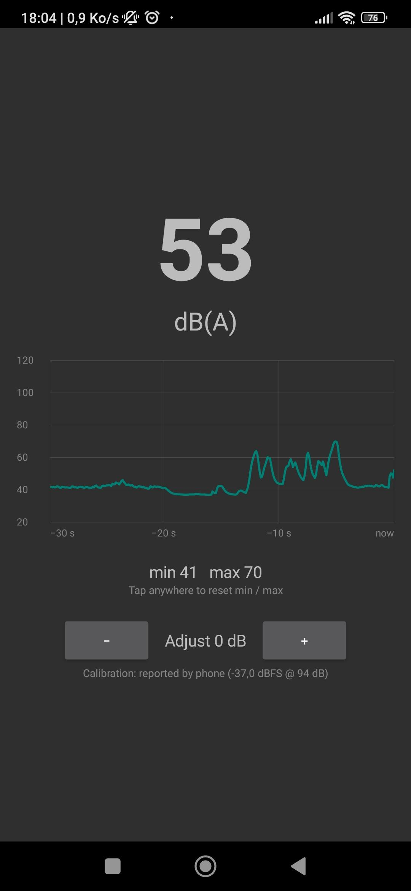

# Sound Meter

A minimal Android app that shows the sound level picked up by your phone's microphone, in real time.

- Current level in **dB(A)**, like a standard sound level meter
- Live graph of the last 30 seconds
- Min / max values (tap anywhere to reset)
- Manual calibration adjustment (− / +), remembered between launches

**Lightweight** (~3 MB), **free**, **no ads**, no tracking, no internet access. The only permission is the microphone.

## Build

Requires Visual Studio with the .NET for Android workload (.NET 10).
Open `SoundMeter.sln`, select your device, press F5.

## License

[MIT](LICENSE). App icon: Google Material Icons, Apache 2.0.
